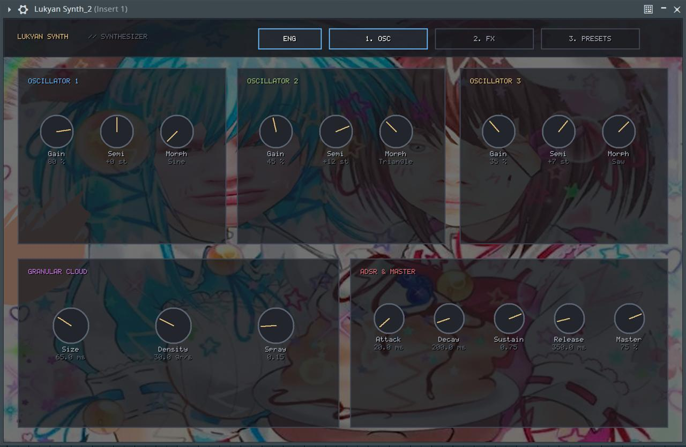
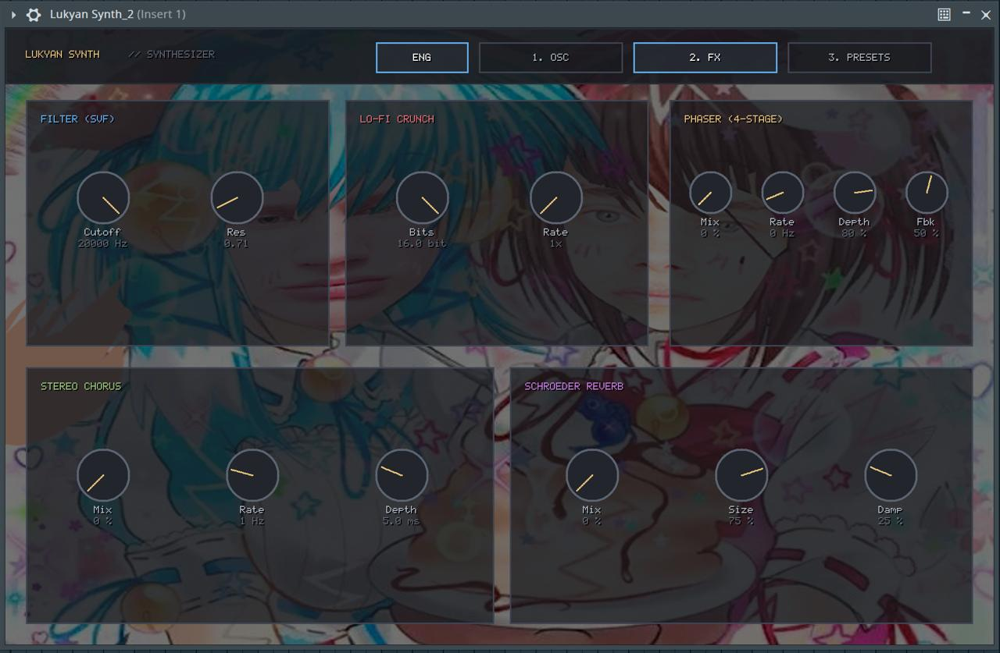
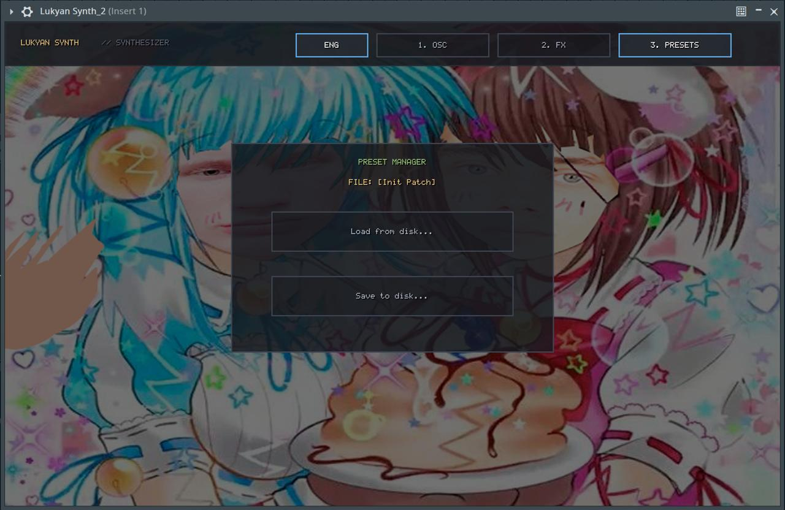

# Lukyan Synth


[](https://tetraminomusic.github.io/lukyan_synth/)
[](docs/doxygen/html/index.html)


Полифонический гранулярный синтезатор, реализованный в стандарте CLAP.<br> 
Проект написан на C с использованием ассемблера x86-64 для оптимизации DSP-обработок. Плагин спроектирован с учётом требований Real-Time Safety, что позволяет работать без аллокаций в аудиопотоке.

## Авторство
* ФИО: Малых Кирилл Романович
* Группа: P3232
* ИСУ: 502873

## Оглавление
- [Интерфейс плагина](#интерфейс-плагина)
- [Архитектура](#архитектура)
- [DSP-математика и оптимизации](#dsp-математика-и-оптимизации)
- [Тестирование](#тестирование)
- [Сборка и установка](#сборка-и-установка)
- [API-документация](#api-документация)

## Интерфейс плагина

### Вкладка 1: Осцилляторы и гранулярный движок


В данной вкладке происходит первоначальный синтез звукого сигнала до примения к нему эффектов.

* __3 независимых осцилятора__ с плавным регулятором формы волны между синусом, треугольником, пилой и квадратом, настройкой громкости сигнала, а также его транспонирование от -24 до +24 полутонов относительно текущей ноты.
* __Гранулярное ядро__ со статическим пулом на 256 зёрен с наложением окна Хэнна для устранения щелчков, регулировкой длины зёрен, плотности генерации и случайного разброса позиции считывания.
* __ADSR-огибающая__ и __мастер-громкость__ звукового сигнала.

### Вкладка 2: Рэк эффектов


В данной вкладке предоставляется возможность наложить эффекты на выходной сигнал синтезатора. 

Доступные эффекты:
* __High-Pass-Filter__ - эффект, позволяющий срезать верхние частоты у выходного сигнала синтезатора с отдельной ручкой Resonance для резкого усилия сигнала на границе фильтра.
* __Bitcrasher__ - эффект, позволяющий намеренно искажать исходный сигнал. Имеет ручки изменения частоты дискретизации и изменения разрешения входного сигнала.
* __Phaser__ - эффект, достигаемый за счёт фильтрацией звукового сигнала с созданием серии максимум и минимум в его спектре. Имеет ручки настройки глубины, громкости и фидбека сигнала в общем миксе, а также частоту свипирования.
* __Stereo Chorus__ - эффект, основанный на дублировании сигнала с небольшой задержкой. Имеет ручки настройки громкости, глубины эффекта, а также частоту изменения "плавучести" звука.
* __Schroerder reverb__ - эффект, позволяющий добавить эффект пространства звуковому сигналу, используя алгоритм Шрёдера. Имеет ручки громкости, размера "команты" и баланса между сухим и сырым сигналом. 


### Вкладка 3: Менеджер работы с пресетами



В данной вкладке предоставляется возможность сохранять и загружать пресеты синтезатора. Пресеты представляют из себя plain-text c списком значений уровней всех ручек внутри синтезатора.  

Примеры пресетов можно посмотреть [в этой папке](./presets).


## Архитектура

Проект разделён на несколько логических слоёв для обеспечения модульности и поддерживаемости:

```
┌────────────────────────────────────────────────────────┐
│                       DAW (Host)                       │
└───────────────────────────┬────────────────────────────┘
                            │ (Events, Audio Buffers, Params)
┌───────────────────────────▼────────────────────────────┐
│ 1. Слой плагина (CLAP Interface: src/plugin.c)         │
│    - Точка входа clap_entry, жизненный цикл плагина    │
│    - Парсинг MIDI (Note On/Off, Pitch Bend)            │
│    - Экспорт параметров, обработка событий             │
│    - Интеграция GUI (CLAP_EXT_GUI)                     │
│    - Управление состоянием (CLAP_EXT_STATE)            │
└───────────────────────────┬────────────────────────────┘
                            │
┌───────────────────────────▼────────────────────────────┐
│ 2. Гранулярный движок (DSP Core: src/dsp/)             │
│    - Пул зёрен (Grain Pool: pre-allocated array)       │
│    - Генератор зёрен (Scheduler / Grain Spawner)       │
│    - Оконная функция Хэнна (Hann LUT)                  │
│    - Интерполятор сэмплов (Linear Interpolation)       │
│    - Генерация 3 осцилляторов с морфингом              │
│    - ADSR-огибающая                                    │
│    - Блок эффектов (фильтр, хорус, реверб, Lo-Fi)      │
└───────────────────────────┬────────────────────────────┘
                            │
┌───────────────────────────▼────────────────────────────┐
│ 3. SIMD Ядро (x86-64 Assembly: src/dsp/simd_math_x86.S)│
│    - Векторное сложение и масштабирование сэмплов      │
│    - Инструкции AVX2 / FMA для параллельной обработки  │
│    - Обработка стерео-каналов за один проход           │
└────────────────────────────────────────────────────────┘
```


## DSP-математика и оптимизации

1.  __Real-Time Safety/Zero-Allocation:__
    *   Вся память предвыделяется в `plugin_activate()`.
    *   В аудиопотоке запрещены `malloc`, `free`, мьютексы и любые системные вызовы.
    *   Используется кастомный **Arena Allocator** для гарантированной нулевой задержки при выделении памяти.

2.  __SIMD-оптимизация:__
    *   Критически важные секции, такие как суммирование зёрен и наложение оконной функции, перенесены в ассемблерный модуль `simd_math_x86.S`.
    *   Используются 256-битные регистры `YMM` для параллельной обработки 8 `float`-сэмплов.
    *   Применяются инструкции `vfmadd231ps` для объединения умножения и сложения в один такт, что значительно ускоряет вычисления.
    
3.  __Быстрая математика:__
    *   Вместо стандартных и медленных `tanhf()` из `libm` используется кубическая аппроксимация `fast_tanhf()`.
    *   Это снижает нагрузку на процессор в блоках сатурации и лимитирования, сохраняя высокое качество звука.

4.  __Блочная обработка:__
    *   Аудио-рендеринг происходит блоками по 8 сэмплов (`SIMD_BLOCK_SIZE`), что идеально соответствует размеру регистров AVX2 и позволяет максимально эффективно использовать SIMD-инструкции.

5.  __Intelligent Auto-Sleep - CLAP_PROCESS_SLEEP:__
    *   Когда все голоса отзвучали и хвосты эффектов затихли, `plugin_process` возвращает флаг `CLAP_PROCESS_SLEEP`.
    *   Это позволяет хосту (DAW) полностью приостановить вызовы плагина, снижая потребление CPU в простое до 0%.

6.  __Кастомный Arena Allocator__:
    *  Вместо стандартного менеджера кучи используется собственный статический аллокатор с выравниванием по 8 байт. Это обеспечивает мгновенное выделение памяти за один такт процессора, исключает фрагментацию и гарантирует идеальную локальность кэша.

## Тестирование

Проект включает в себя набор тестов для проверки корректности работы всех модулей.
*   **`Unit_ArenaAllocator`:** Проверяет корректность работы менеджера памяти.
*   **`Unit_DspMathParity`:** Проверяет точность быстрой математики и SIMD-функций.
*   **`Unit_PresetSerialization`:** Проверяет сериализацию и десериализацию пресетов.
*   **`Integration_GoldenAudio`:** Интеграционный тест, который рендерит аудио и сравнивает его с эталонным снимком, используя среднеквадратичную ошибку (RMSE).

Для запуска тестов локально, из папки `build` выполни:
```bash
ctest --output-on-failure
```    


## Сборка и установка

### Сборка на macOS:
```bash
mkdir build && cd build
cmake ..
cmake --build .
```
Скомпилированный бандл `Lukyan Synth.clap` автоматически копируется в системную папку `~/Library/Audio/Plug-Ins/CLAP/`.

### Сборка на Windows:
```cmd
mkdir build && cd build
cmake ..
cmake --build . --config Release
```
Скомпилированный файл копируется в `C:\Program Files\Common Files\CLAP\`.

В разделе `Actions` доступны пайланы автоматической сборки плагина в формате `.vst3` (подходит для старых версий DAW с некоторыми ограничениями) и `.clap`.  

### Совместимость с DAW
Плагин можно использовать в следующих DAW:
* __FL Studio__ (нативно от версии 24, а также в старых версиях через VST3-оболочку)
* __Cockos REAPER__
* __Bitwig Studio__

## API-документация

Полная автоматически сгенерированная документация API доступна по
<a href="https://tetraminomusic.github.io/lukyan_synth/" target="_blank">следующей ссылке</a>.

Документация обновляется автоматически при каждом пуше в `main` через GitHub Actions.

Для локальной генерации:
```bash
doxygen Doxyfile
open docs/doxygen/html/index.html
```